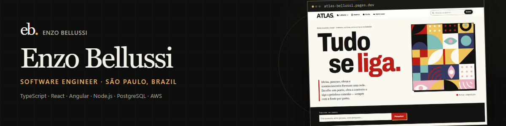
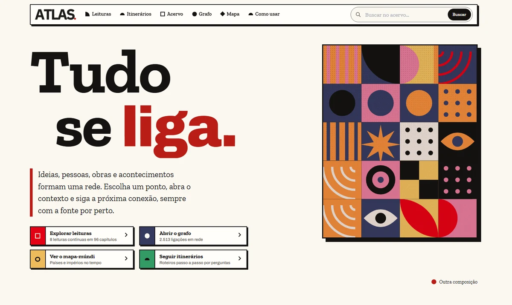

  
   
  <a href="https://bellussi.vercel.app">Portfolio</a>
  &nbsp;·&nbsp;
  <a href="https://www.linkedin.com/in/enzo-bellussi/">LinkedIn</a>
  &nbsp;·&nbsp;
  <a href="mailto:enzobellussi3@gmail.com">Email</a>
  &nbsp;·&nbsp;
  <a href="https://bellussi.vercel.app/curriculo-en.pdf">Resume</a>

## Hi, I'm Enzo

I'm a **software engineer** based in São Paulo, Brazil. I build and maintain enterprise web products and open-source tools, with **front-end depth and range across the stack**.

My core is **TypeScript, React, Angular and Node.js**. Around it: REST APIs, PostgreSQL, AWS, Docker, CI/CD and test automation. I care about performance, accessibility and code that teams can keep evolving after launch.

- **Software Engineer (Front-end)** at **MarketData** — enterprise products for retail, energy, mobility and payments.
- Technical owner for **Dexco** and **RecargaPay**; previously at **Banco do Brasil**.
- Open-source maintainer of **[ATLAS](https://github.com/bellussi1/ATLAS)**, a live knowledge product with **896 entities, 7,918 sourced claims and 898 sources**.
- Open to **software engineering roles** — front-end, product engineering and full-stack growth.
- Currently deepening: **Java/Spring, AWS and distributed systems**.

## Flagship project — ATLAS

**[ATLAS](https://atlas-bellussi.pages.dev)** is an interactive encyclopedia of history, politics and society built on a typed knowledge graph. People, works, concepts and events connect as a navigable network, and every claim shows its source plus whether it is documented fact, interpretation, controversy or an acknowledged gap.

**Engineering highlights**

- **Angular 21** with Signals, standalone components and prerendering; strict TypeScript and Zod-validated content.
- Reproducible Wikimedia ingestion, static-first delivery and content published as immutable objects on **Cloudflare R2**.
- **Playwright + axe** accessibility and end-to-end tests; architecture boundaries enforced with ESLint.
- Bilingual editorial product with sourced claims, stable entity IDs and typed relations.

[Live product](https://atlas-bellussi.pages.dev) · [Source code](https://github.com/bellussi1/ATLAS) · [Contributing guide](https://github.com/bellussi1/ATLAS/blob/master/CONTRIBUTING.md)

## Selected work

| Project | What it is | Stack / status |
| --- | --- | --- |
| **[ATLAS](https://github.com/bellussi1/ATLAS)** · [live](https://atlas-bellussi.pages.dev) | Visual encyclopedia of history, politics and society with sources behind every claim. | Angular 21 · TypeScript · Zod · Cloudflare R2 · Static-first |
| **[KOReader Ecosystem](https://github.com/bellussi1/koreader-ecosystem)** | Local-first Windows companion for Calibre, KOReader, Kindle and Hardcover. | Electron · React · TypeScript · Python · Open source |
| **[Dalibre](https://github.com/bellussi1/dalibre)** · [plugin template](https://github.com/bellussi1/dalibre-plugin-template) | Fork and upstream contributions to a lightweight native Calibre alternative (pt-BR localization, Lusophone book stores, list sorting and SDK types). | Go · MyGo UI · SQLite · JavaScript |
| **[Scriptorium](https://github.com/bellussi1/Scriptorium)** | Personal fork of TranslateBooksWithLLMs for resumable literary book translation into Brazilian Portuguese via local Ollama models. | Python · Ollama · Docker Compose · EPUB |
| **[Black Market](https://github.com/bellussi1/Black-Market)** | Production and market planner for the Brazilian Black Desert Online community. | Angular SSR · NestJS · PostgreSQL · Drizzle · Docker |
| **[Comandinha](https://github.com/bellussi1/comandinha)** | Restaurant operations platform with digital menus, tables, orders and QR ordering. | Next.js · React · NestJS · PostgreSQL · Prisma |
| **[Portfolio](https://github.com/bellussi1/bellussi-portifolio)** · [live](https://bellussi.vercel.app) | English-first portfolio with Portuguese version, case studies and ATS-oriented resumes. | HTML · CSS · TypeScript · Vite · Lighthouse 100 |

### Developer tools & plugins

| Tool | What it does | Stack |
| --- | --- | --- |
| **[Dalibre Hardcover](https://github.com/bellussi1/dalibre-hardcover)** | Two-way Hardcover reading status sync and metadata plugin for Dalibre, paired with KOReader via ISBN. | JavaScript · GraphQL · Dalibre SDK |
| **[Dalibre ISBN Brasil](https://github.com/bellussi1/dalibre-isbn-brasil)** | Brazilian ISBN (`978-65` / `978-85`) metadata plugin via CBL/BrasilAPI with Open Library fallback. | JavaScript · BrasilAPI · Dalibre SDK |
| **[Dalibre Open Library](https://github.com/bellussi1/dalibre-openlibrary)** | Open Library metadata source plugin for Dalibre prioritizing matching-language editions. | JavaScript · Open Library · Dalibre SDK |
| **[Deploy Preflight](https://github.com/bellussi1/deploy-preflight)** | Validates environment variables, build artifacts and endpoints before deployment. | TypeScript · Node.js · GitHub Actions |
| **[Local Webhook Recorder](https://github.com/bellussi1/local-webhook-recorder)** | Captures webhooks in local SQLite and replays them to loopback handlers. | TypeScript · Node.js · SQLite |
| **[Compose Doctor](https://github.com/bellussi1/compose-doctor)** | Read-only Docker Compose diagnostics with actionable CLI reports. | TypeScript · Docker Compose · CLI |

## Experience

**MarketData** · Mid-level Software Engineer (Front-end) · Aug 2024 – Present  
Enterprise SPAs in Angular and React for clients including Natura, Nissan, Dexco, RecargaPay, Patriá and Visa network testers. Technical owner for Dexco and RecargaPay.

**Banco do Brasil** · Software Engineer Intern (Front-end) · Oct 2022 – Aug 2024  
Internal portal for the International Business Unit. Rebuilt a legacy system in Vue.js, maintained the internal Design System and integrated Node.js microservices.

**B.Sc. in Computer Science** · Universidade FAM · 2022–2025

## Toolbox

**Languages:** TypeScript · JavaScript (ES6+) · SQL · HTML5 · CSS3  
**Front end:** React · Next.js · Angular · RxJS · Vue.js · Tailwind CSS · SASS  
**Back end & data:** Node.js · NestJS · REST APIs · PostgreSQL · Prisma · Drizzle · ASP.NET MVC  
**Cloud & DevOps:** AWS · Docker · GitLab CI/CD · GitHub Actions · Vercel · Cloudflare  
**Engineering:** Design Systems · web performance · Core Web Vitals · WCAG accessibility · technical SEO · Vitest · Playwright · axe · AI-assisted development

## Contact

- **Portfolio:** [bellussi.vercel.app](https://bellussi.vercel.app)
- **LinkedIn:** [in/enzo-bellussi](https://www.linkedin.com/in/enzo-bellussi/)
- **Email:** [enzobellussi3@gmail.com](mailto:enzobellussi3@gmail.com)
- **Resume:** [English](https://bellussi.vercel.app/curriculo-en.pdf) · [Português](https://bellussi.vercel.app/curriculo-pt.pdf)

---

<strong>Português</strong>

## Olá, sou o Enzo

Sou **engenheiro de software** em São Paulo. Construo e mantenho produtos web corporativos e ferramentas open source, com **profundidade em front-end e repertório em toda a stack**.

Meu núcleo é **TypeScript, React, Angular e Node.js**. Ao redor: APIs REST, PostgreSQL, AWS, Docker, CI/CD e testes automatizados. Me importo com performance, acessibilidade e código que os times conseguem evoluir depois do deploy.

- **Engenheiro de Software (Front-end)** na **MarketData** — produtos corporativos para varejo, energia, mobilidade e pagamentos.
- Responsável técnico pelos projetos **Dexco** e **RecargaPay**; antes, no **Banco do Brasil**.
- Mantenedor open source do **[ATLAS](https://github.com/bellussi1/ATLAS)**, produto de conhecimento no ar com **896 entidades, 7.918 afirmações com fonte e 898 fontes**.
- Aberto a **posições de engenharia de software** — front-end, engenharia de produto e crescimento full-stack.
- Aprofundando agora: **Java/Spring, AWS e sistemas distribuídos**.

### Projeto principal

**[ATLAS](https://atlas-bellussi.pages.dev)** é uma enciclopédia interativa de história, política e sociedade construída sobre um grafo de conhecimento tipado. Pessoas, obras, conceitos e acontecimentos formam uma rede navegável, e cada afirmação mostra sua fonte e se é fato documentado, interpretação, controvérsia ou lacuna assumida.

**Stack:** Angular 21 · TypeScript strict · Signals · Zod · Playwright · axe · Cloudflare R2 · static-first.

### Projetos e ferramentas

| Projeto / ferramenta | O que faz | Stack / estado |
| --- | --- | --- |
| **[ATLAS](https://github.com/bellussi1/ATLAS)** · [ao vivo](https://atlas-bellussi.pages.dev) | Enciclopédia visual de história, política e sociedade com fontes em cada afirmação. | Angular 21 · TypeScript · Zod · Cloudflare R2 · Static-first |
| **[KOReader Ecosystem](https://github.com/bellussi1/koreader-ecosystem)** | Aplicativo Windows local-first para Calibre, KOReader, Kindle e Hardcover. | Electron · React · TypeScript · Python · Open source |
| **[Dalibre](https://github.com/bellussi1/dalibre)** · [template](https://github.com/bellussi1/dalibre-plugin-template) | Fork e contribuições upstream para alternativa nativa ao Calibre (tradução pt-BR, lojas lusófonas, ordenação e SDK). | Go · MyGo UI · SQLite · JavaScript |
| **[Scriptorium](https://github.com/bellussi1/Scriptorium)** | Fork pessoal de TranslateBooksWithLLMs para tradução literária retomável para pt-BR via Ollama. | Python · Ollama · Docker Compose · EPUB |
| **[Dalibre Hardcover](https://github.com/bellussi1/dalibre-hardcover)** | Plugin para Dalibre de sincronização bidirecional de leitura e metadados com o Hardcover. | JavaScript · GraphQL · Dalibre SDK |
| **[Dalibre ISBN Brasil](https://github.com/bellussi1/dalibre-isbn-brasil)** | Plugin de metadados brasileiros (`978-65` / `978-85`) via CBL/BrasilAPI com fallback na Open Library. | JavaScript · BrasilAPI · Dalibre SDK |
| **[Dalibre Open Library](https://github.com/bellussi1/dalibre-openlibrary)** | Plugin de busca de metadados na Open Library para o Dalibre com foco em edições no idioma do livro. | JavaScript · Open Library · Dalibre SDK |
| **[Black Market](https://github.com/bellussi1/Black-Market)** | Planejador de produção e mercado para a comunidade brasileira de Black Desert Online. | Angular SSR · NestJS · PostgreSQL · Drizzle · Docker |
| **[Comandinha](https://github.com/bellussi1/comandinha)** | Plataforma de operação para restaurantes com cardápio digital, mesas, pedidos e QR Code. | Next.js · React · NestJS · PostgreSQL · Prisma |
| **[Deploy Preflight](https://github.com/bellussi1/deploy-preflight)** | Valida variáveis de ambiente, artefatos de build e endpoints antes do deploy. | TypeScript · Node.js · GitHub Actions |
| **[Local Webhook Recorder](https://github.com/bellussi1/local-webhook-recorder)** | Captura webhooks em SQLite local e reproduz eventos para handlers locais. | TypeScript · Node.js · SQLite |
| **[Compose Doctor](https://github.com/bellussi1/compose-doctor)** | Diagnóstico somente leitura de serviços Docker Compose com relatórios no terminal. | TypeScript · Docker Compose · CLI |

### Experiência

**MarketData** · Engenheiro de Software Pleno (Front-end) · ago. 2024 – atual  
**Banco do Brasil** · Estagiário em Engenharia de Software (Front-end) · out. 2022 – ago. 2024  
**Ciência da Computação** · Universidade FAM · 2022–2025

### Contato

[Portfólio](https://bellussi.vercel.app) · [LinkedIn](https://www.linkedin.com/in/enzo-bellussi/) · [Email](mailto:enzobellussi3@gmail.com) · [Currículo PT](https://bellussi.vercel.app/curriculo-pt.pdf) · [Resume EN](https://bellussi.vercel.app/curriculo-en.pdf)

