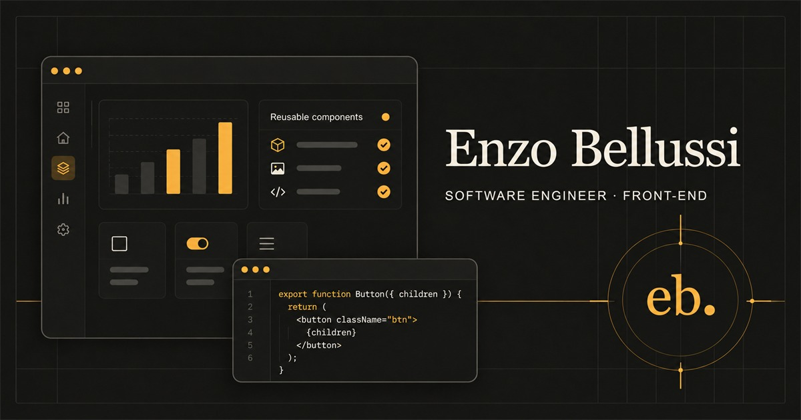

  
   
  <a href="https://bellussi.vercel.app">Portfólio</a>
  &nbsp;·&nbsp;
  <a href="https://www.linkedin.com/in/enzo-bellussi/">LinkedIn</a>

## Sobre

Sou Software Engineer com foco em front-end. Na **MarketData**, trabalho com React, Angular e TypeScript em produtos corporativos, incluindo projetos para Dexco e RecargaPay. Antes, atuei no **Banco do Brasil** com Vue.js, componentes de Design System e integrações com serviços Node.js.

Estou aberto a oportunidades em engenharia de software, especialmente front-end. [Vamos conversar pelo LinkedIn](https://www.linkedin.com/in/enzo-bellussi/).

## Projeto principal

### [Portfólio · bellussi.vercel.app](https://bellussi.vercel.app)

Meu espaço profissional para apresentar minha trajetória, experiência e projetos. O site reúne estudos de caso e ferramentas open source em uma experiência responsiva, acessível e focada em facilitar o contato com recrutadores e equipes de tecnologia. [Ver código-fonte](https://github.com/bellussi1/bellussi-portifolio).

## Projetos

| Projeto | O que faz | Tecnologias / estado |
| --- | --- | --- |
| [Comandinha](https://github.com/bellussi1/comandinha) | Plataforma de operação para restaurantes: catálogo, mesas, pedidos e cardápio por QR. | Next.js · NestJS · PostgreSQL · Em modernização |
| [Black Market](https://github.com/bellussi1/Black-Market) | SaaS para apoiar a organização de inventário e receitas de criação da comunidade brasileira de Black Desert Online. | Projeto privado · Em desenvolvimento |
| [Deploy Preflight](https://github.com/bellussi1/deploy-preflight) · [CI](https://github.com/bellussi1/deploy-preflight/actions/workflows/ci.yml) | Confere variáveis, arquivos e URLs antes de um deploy. | Node.js · CLI |
| [Local Webhook Recorder](https://github.com/bellussi1/local-webhook-recorder) · [CI](https://github.com/bellussi1/local-webhook-recorder/actions/workflows/ci.yml) | Captura, inspeciona e reproduz webhooks em ambientes locais. | Node.js · SQLite |
| [Compose Doctor](https://github.com/bellussi1/compose-doctor) · [CI](https://github.com/bellussi1/compose-doctor/actions/workflows/ci.yml) | Diagnostica serviços Docker Compose e sugere próximos passos. | Node.js · Docker |

## Carreira e formação

**MarketData** · Desenvolvedor Front-end · ago. 2024–atual 
**Banco do Brasil** · Estagiário de desenvolvimento Front-end · out. 2022–ago. 2024 
**Ciência da Computação** · Universidade FAM · 2022–2025 
Português nativo · Inglês avançado

## Tecnologias

React · Angular · Vue.js · Next.js · TypeScript · Node.js · NestJS · PostgreSQL · Prisma · Docker · AWS · CI/CD

## Contribuições open source

[Mihon #4110](https://github.com/mihonapp/mihon/pull/4110) · [Shiori #1216](https://github.com/go-shiori/shiori/pull/1216) · [Paisa #417](https://github.com/ananthakumaran/paisa/pull/417) · [Openreads #913](https://github.com/mateusz-bak/openreads/pull/913)

---

  
English version

## About

I am a Software Engineer focused on front-end development. At **MarketData**, I work with React, Angular and TypeScript on enterprise products, including projects for Dexco and RecargaPay. Previously, I worked at **Banco do Brasil** with Vue.js, Design System components and Node.js service integrations.

I am open to software engineering opportunities, especially front-end roles. [Connect with me on LinkedIn](https://www.linkedin.com/in/enzo-bellussi/).

## Featured project

### [Portfolio · bellussi.vercel.app](https://bellussi.vercel.app)

My professional home for sharing my experience, career and projects. It brings together case studies and open-source tools in a responsive, accessible experience designed to make it easy for recruiters and engineering teams to get in touch. [Source code](https://github.com/bellussi1/bellussi-portifolio).

## Projects

| Project | What it does | Technology / status |
| --- | --- | --- |
| [Comandinha](https://github.com/bellussi1/comandinha) | Restaurant operations platform for catalogs, tables, orders and QR menus. | Next.js · NestJS · PostgreSQL · Modernization in progress |
| [Black Market](https://github.com/bellussi1/Black-Market) | SaaS supporting inventory and crafting recipe organization for Brazil's Black Desert Online community. | Private · In development |
| [Deploy Preflight](https://github.com/bellussi1/deploy-preflight) · [CI](https://github.com/bellussi1/deploy-preflight/actions/workflows/ci.yml) | Checks variables, files and URLs before deployment. | Node.js · CLI |
| [Local Webhook Recorder](https://github.com/bellussi1/local-webhook-recorder) · [CI](https://github.com/bellussi1/local-webhook-recorder/actions/workflows/ci.yml) | Captures, inspects and replays webhooks in local environments. | Node.js · SQLite |
| [Compose Doctor](https://github.com/bellussi1/compose-doctor) · [CI](https://github.com/bellussi1/compose-doctor/actions/workflows/ci.yml) | Diagnoses Docker Compose services and suggests next steps. | Node.js · Docker |

## Career and education

**MarketData** · Front-end Developer · Aug 2024–present 
**Banco do Brasil** · Front-end Development Intern · Oct 2022–Aug 2024 
**Computer Science** · Universidade FAM · 2022–2025 
Native Portuguese · Advanced English

## Technologies

React · Angular · Vue.js · Next.js · TypeScript · Node.js · NestJS · PostgreSQL · Prisma · Docker · AWS · CI/CD

[Portfolio](https://bellussi.vercel.app) · [LinkedIn](https://www.linkedin.com/in/enzo-bellussi/)

