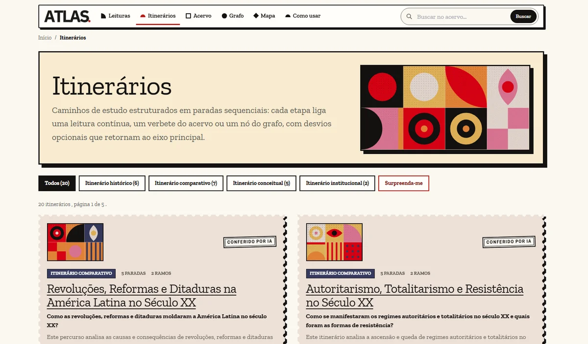
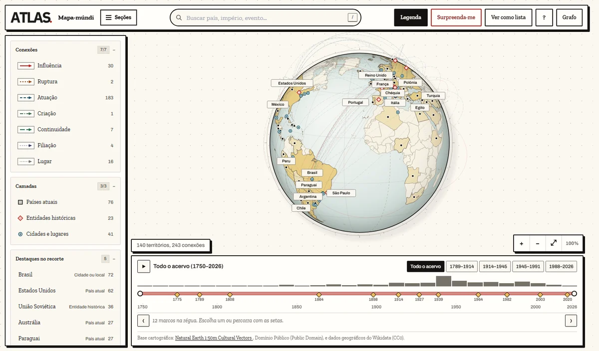

  
   
  <a href="https://bellussi.vercel.app">Portfolio</a>
  &nbsp;·&nbsp;
  <a href="https://www.linkedin.com/in/enzo-bellussi/">LinkedIn</a>
  &nbsp;·&nbsp;
  <a href="mailto:enzobellussi3@gmail.com">Email</a>
  &nbsp;·&nbsp;
  <a href="https://bellussi.vercel.app/curriculo-en.pdf">Resume</a>

## Hi, I'm Enzo

Software engineer in São Paulo, Brazil. Front-end architecture, design systems, performance and accessibility, with TypeScript, Angular, React and Node.js. Mid-level Software Engineer at **MarketData**, technical owner for Dexco and RecargaPay; previously at Banco do Brasil.

Open to software engineering roles.

## Building: ATLAS

**[ATLAS](https://atlas-bellussi.pages.dev)** is an open-source visual encyclopedia of history, politics, economics and society. People, works, concepts and events form one typed knowledge graph (**1,320 entities, 12,146 claims with citations, 1,482 sources**), and every claim is classified as documented fact, attributed thesis, interpretation or contested claim.

<table>
  <tr>
    <td width="50%"> <b>Readings</b> · continuous text with sources beside each claim</td>
    <td width="50%"> <b>Itineraries</b> · step-by-step routes through the graph</td>
  </tr>
  <tr>
    <td width="50%"> <b>Graph</b> · the whole network, with search and paths</td>
    <td width="50%"> <b>Map</b> · countries and empires on a globe, 1750 to 2026</td>
  </tr>
</table>

**Under the hood:** Angular 21 (Signals, prerender), strict TypeScript, Zod-validated content, reproducible Wikipedia/Wikidata/Commons ingestion, content-addressed releases on Cloudflare R2, Playwright + axe in CI, and LLM-assisted extraction that keeps only verbatim citations and never publishes on its own.

[Live](https://atlas-bellussi.pages.dev) · [Source](https://github.com/bellussi1/ATLAS) · [Contribute](https://github.com/bellussi1/ATLAS/blob/master/CONTRIBUTING.md)

## Also

- **[KOReader Ecosystem](https://github.com/bellussi1/koreader-ecosystem)**: local-first Windows companion for Calibre, KOReader, Kindle and Hardcover (Electron, React, Python).
- **[Deploy Preflight](https://github.com/bellussi1/deploy-preflight)**: validates environment variables, build artifacts and endpoints before a deploy (TypeScript CLI).
- **[Compose Doctor](https://github.com/bellussi1/compose-doctor)**: read-only Docker Compose diagnostics (TypeScript CLI).
- More on my [profile](https://github.com/bellussi1?tab=repositories) and in the [portfolio](https://bellussi.vercel.app).

---

<strong>Português</strong>

Engenheiro de software em São Paulo. Arquitetura front-end, design systems, performance e acessibilidade, com TypeScript, Angular, React e Node.js. Engenheiro de Software Pleno na **MarketData**, responsável técnico por Dexco e RecargaPay; antes, no Banco do Brasil. Aberto a posições de engenharia de software.

**[ATLAS](https://atlas-bellussi.pages.dev)** é uma enciclopédia visual open source de história, política, economia e sociedade, sobre um grafo de conhecimento tipado: **1.320 entidades, 12.146 afirmações com citação e 1.482 fontes**. Cada afirmação é classificada como fato documentado, tese atribuída, interpretação ou afirmação controversa. [Site](https://atlas-bellussi.pages.dev) · [Código](https://github.com/bellussi1/ATLAS) · [Como contribuir](https://github.com/bellussi1/ATLAS/blob/master/CONTRIBUTING.md)

Currículo: [PT](https://bellussi.vercel.app/curriculo-pt.pdf) · [EN](https://bellussi.vercel.app/curriculo-en.pdf)

