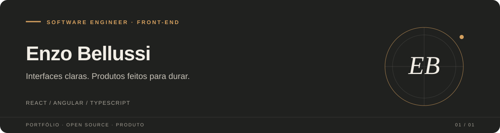

  
   
  <a href="https://bellussi.vercel.app">Portfólio</a>
  &nbsp;·&nbsp;
  <a href="https://www.linkedin.com/in/enzo-bellussi/">LinkedIn</a>

## Sobre

Sou Software Engineer com foco em front-end. Trabalho na construção e evolução de aplicações web, conectando decisões de interface a necessidades reais de produto. Gosto de código claro, experiências acessíveis e soluções que continuem fáceis de manter.

Atualmente estou na **MarketData**, trabalhando com React, Angular e TypeScript em produtos corporativos. Tenho experiência anterior no **Banco do Brasil**, onde atuei em aplicações internas, componentes reutilizáveis e integrações com serviços Node.js.

**Estou aberto a conversar sobre oportunidades em engenharia de software, especialmente front-end.** [Me encontre no LinkedIn](https://www.linkedin.com/in/enzo-bellussi/).

## Open source

Pequenas ferramentas para tornar tarefas comuns de desenvolvimento e operação mais previsíveis. Os badges mostram o estado do CI na branch principal.

### Deploy Preflight

CLI em Node.js que verifica variáveis de ambiente, arquivos e URLs antes de um deploy. A ideia é encontrar configurações ausentes enquanto ainda é simples corrigi-las.

[Código e documentação](https://github.com/bellussi1/deploy-preflight)

### Local Webhook Recorder

Ferramenta local para capturar e inspecionar webhooks durante o desenvolvimento, armazenando eventos em SQLite e permitindo replay controlado em endpoints locais.

[Código e documentação](https://github.com/bellussi1/local-webhook-recorder)

### Compose Doctor

Diagnóstico somente de leitura para serviços Docker Compose. Ajuda a entender por que um serviço não está pronto e sugere comandos para investigar, no terminal ou no CI.

[Código e documentação](https://github.com/bellussi1/compose-doctor)

## Produtos

### Comandinha

Plataforma de operação para restaurantes, com catálogo, mesas, pedidos e cardápio por QR. Estou modernizando a aplicação em uma base Next.js, NestJS, PostgreSQL e Prisma; a migração continua em andamento e o produto ainda não está pronto para produção.

[Repositório](https://github.com/bellussi1/comandinha)

### Black Market

SaaS privado em desenvolvimento para a comunidade brasileira de **Black Desert Online**, pensado para apoiar a organização de inventário e informações de receitas de criação. O projeto segue privado e em evolução.

## Experiência

**MarketData** · Desenvolvedor Front-end · ago. 2024–atual 
Desenvolvimento de aplicações corporativas com React, Angular e TypeScript. Atuação técnica em projetos para Dexco e RecargaPay, integrações com APIs e entregas em produção.

**Banco do Brasil** · Estagiário de desenvolvimento Front-end · out. 2022–ago. 2024 
Refatoração de portal interno em Vue.js, criação de componentes reutilizáveis para Design System e integração com microsserviços Node.js.

## Contribuições em revisão

PRs abertas em projetos que uso ou acompanho. O status pode mudar conforme a revisão dos mantenedores.

- [Mihon #4110](https://github.com/mihonapp/mihon/pull/4110) · evita que imagens temporárias de capítulos apareçam na galeria do dispositivo.
- [Shiori #1216](https://github.com/go-shiori/shiori/pull/1216) · melhora a seleção de URLs nas mensagens do comando `shiori check`.
- [Paisa #417](https://github.com/ananthakumaran/paisa/pull/417) · mantém totais de gráficos visíveis em tooltips com pouco espaço.
- [Openreads #913](https://github.com/mateusz-bak/openreads/pull/913) · exibe subtítulos de livros nas listas e cartões.

## Ferramentas do dia a dia

- **Interfaces:** React, Angular, Vue.js, Next.js, TypeScript
- **Serviços e dados:** Node.js, NestJS, PostgreSQL, Prisma
- **Entrega e operação:** Docker, AWS, CI/CD

## Formação

**Ciência da Computação** · Universidade FAM · 2022–2025 
Português nativo · Inglês avançado

---

  
English version

## About

I am a Software Engineer focused on front-end development. I build and evolve web applications, connecting interface decisions to real product needs. I value clear code, accessible experiences and solutions that remain easy to maintain.

I currently work at **MarketData**, building enterprise products with React, Angular and TypeScript. Before that, I worked at **Banco do Brasil** on internal applications, reusable components and integrations with Node.js services.

**I am open to conversations about software engineering opportunities, especially front-end roles.** [Find me on LinkedIn](https://www.linkedin.com/in/enzo-bellussi/).

## Open source

Small tools that make common development and operations tasks more predictable. The badges show CI status on each repository's default branch.

### Deploy Preflight

A Node.js CLI that checks environment variables, files and URLs before deployment, catching missing configuration while it is still easy to fix.

[Source and documentation](https://github.com/bellussi1/deploy-preflight)

### Local Webhook Recorder

A local tool for capturing and inspecting webhooks during development. It stores events in SQLite and supports controlled replay to local endpoints.

[Source and documentation](https://github.com/bellussi1/local-webhook-recorder)

### Compose Doctor

Read-only diagnostics for Docker Compose services. It helps explain why a service is not ready and suggests investigation commands for the terminal or CI.

[Source and documentation](https://github.com/bellussi1/compose-doctor)

## Products

### Comandinha

Restaurant operations platform for catalogs, tables, orders and QR menus. I am modernizing it with a Next.js, NestJS, PostgreSQL and Prisma foundation. The migration is ongoing and the product is not production-ready yet.

[Repository](https://github.com/bellussi1/comandinha)

### Black Market

A private SaaS in development for Brazil's **Black Desert Online** community, designed to help organize inventory and crafting recipe information. The project remains private and under active development.

## Experience

**MarketData** · Front-end Developer · Aug 2024–present 
Enterprise applications with React, Angular and TypeScript. Technical work across projects for Dexco and RecargaPay, API integrations and production releases.

**Banco do Brasil** · Front-end Development Intern · Oct 2022–Aug 2024 
Refactored an internal portal with Vue.js, built reusable Design System components and integrated Node.js microservices.

## Contributions under review

Open pull requests in projects I use or follow. Their status may change as maintainers review them.

- [Mihon #4110](https://github.com/mihonapp/mihon/pull/4110) · keeps temporary chapter images out of the device gallery.
- [Shiori #1216](https://github.com/go-shiori/shiori/pull/1216) · makes URLs easier to select in `shiori check` output.
- [Paisa #417](https://github.com/ananthakumaran/paisa/pull/417) · keeps chart totals visible in tooltips with limited space.
- [Openreads #913](https://github.com/mateusz-bak/openreads/pull/913) · shows book subtitles in lists and cards.

## Tools I use

- **Interfaces:** React, Angular, Vue.js, Next.js, TypeScript
- **Services and data:** Node.js, NestJS, PostgreSQL, Prisma
- **Delivery and operations:** Docker, AWS, CI/CD

## Education

**Computer Science** · Universidade FAM · 2022–2025 
Native Portuguese · Advanced English

[Portfolio](https://bellussi.vercel.app) · [LinkedIn](https://www.linkedin.com/in/enzo-bellussi/)

